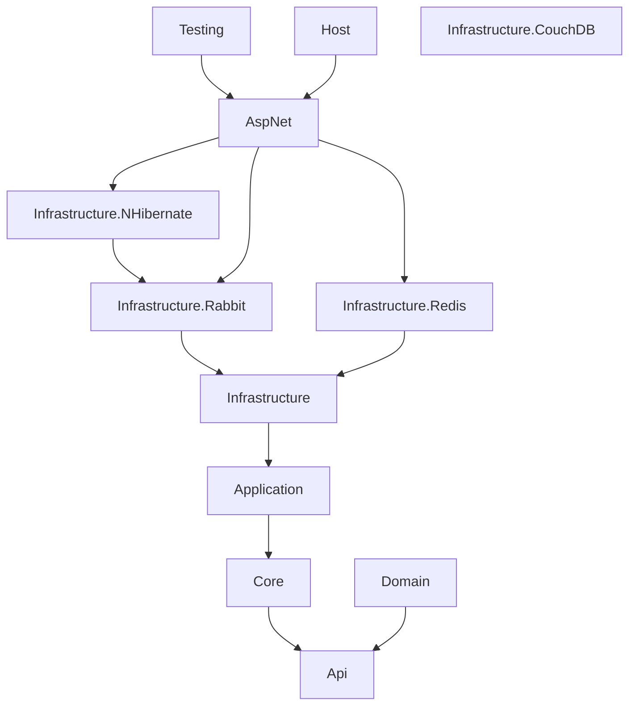
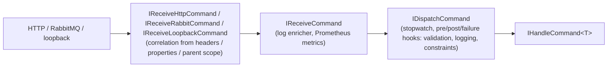

[Magyar](../hu/overview.md) | **English**

# Overview

## Packages

The packages are published with the `Sarkany.` prefix (e.g. `Sarkany.ServiceComponents.AspNet`); the assemblies and namespaces are the names below.

| Package | Contents |
|---|---|
| `ServiceComponents.Api` | Message contracts: `Command`, `Query<TResult>`, `Event`, `RoutableEvent`, `ICommand`/`IQuery`/`IEvent`. Reference it from your service's API assembly. |
| `ServiceComponents.Core` | Value objects, `Enumeration`, `TimeInterval`, `IClock`, business exceptions (`BusinessException`, `NotFoundException`, `ConflictException`, `GoneException`). |
| `ServiceComponents.Domain` | `EventSourcedAggregateRoot` and repository interfaces. |
| `ServiceComponents.Application` | Handler interfaces and base classes (`HandleCommand<T>`, `HandleQuery<T,R>`, `HandleEvent<T>`), pre/post/failure hooks, `ISendCommand`, `ISendQuery`, `IPublishEvent`, `ICorrelation`, metric attributes. |
| `ServiceComponents.Infrastructure` | Mediator (dispatchers and hooks), receivers, routers, loopback transport, behaviors (validation, logging, stopwatch, correlation, request constraints), Prometheus metrics, event recorder. |
| `ServiceComponents.Infrastructure.Rabbit` | RabbitMQ connections, channels, consumers, senders, retry topology. |
| `ServiceComponents.AspNet` | HTTP receivers and senders, error handling middleware and JSON error contract, `ServiceComponentsHostBuilder` wireup, health checks, metrics endpoint, OpenAPI. |
| `ServiceComponents.Infrastructure.Redis` | Redis connection and database registration. |
| `ServiceComponents.Infrastructure.NHibernate` | NHibernate (PostgreSQL) session registration. |
| `ServiceComponents.Infrastructure.CouchDB` | Configuration source loading a CouchDB document. |
| `ServiceComponents.Host` | Status badges (`AddBadges`). |
| `ServiceComponents.Testing` | `TestHost<TEntryPoint>` / `Test<THost>` for in-memory host tests, publisher mock helpers. |



All packages use Autofac (`ContainerBuilder` extension methods), Serilog (`Serilog.ILogger` injected into every component) and Newtonsoft.Json on the wire.

## Request flow

**Incoming:** transport → receiver → transport-specific behaviors → receiver behaviors → dispatcher behaviors → dispatcher → handler



Queries and events follow the same path:

- queries go through `IReceiveQuery`/`IDispatchQuery` and return a result;
- events go through `IReceiveEvent`/`IDispatchEvent`, and every `IHandleEvent<T>` runs concurrently.

**Outgoing:** handler → `ISendCommand` / `ISendQuery` / `IPublishEvent` → router (selects a keyed sender) → transport sender (correlation behavior) → wire

Routers pick the sender by key. The keys used by the built-in wireup are:

| Key | Registered by |
|---|---|
| `"loopback"` | `UseDefault`: in-process |
| `"rabbit"` | `AddRabbit` |
| any key you pass | `AddHttpSender(uri, key)` |

## Composition

A service is composed in `Program.CreateHostBuilder` with `ServiceComponentsHostBuilder`, which collects callbacks for the host, services, the Autofac container, MVC and the application pipeline:

```csharp
new ServiceComponentsHostBuilder()
    .UseDefault(apiAssemblies, applicationAssemblies)   // Autofac, MVC, mediator, behaviors, correlation, receivers, loopback sender
    .AddRabbit(...)                                     // optional RabbitMQ transport
    .AddHttpSender(uri, "http")                         // optional HTTP sender
    .AddCommandRouter(command => "loopback")            // where outgoing messages go
    .AddQueryRouter(query => "http")
    .AddEventRouter(@event => "rabbit")
    .CreateHostBuilder(args);
```

See [Getting started](getting-started.md) for a complete service.
