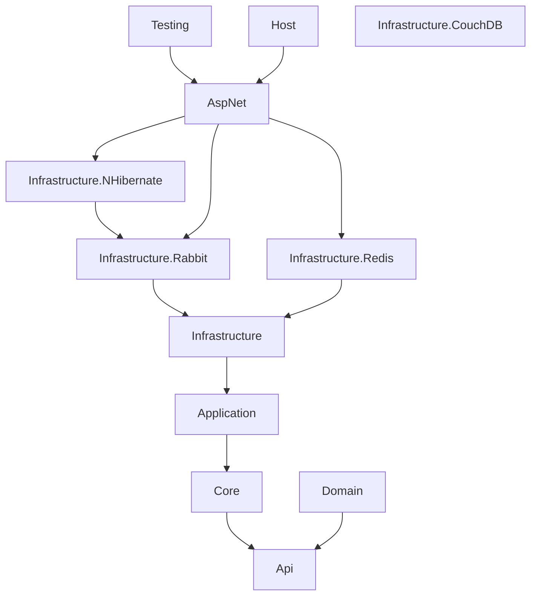
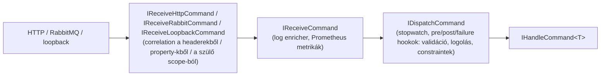

**Magyar** | [English](../en/overview.md)

# Áttekintés

## Csomagok

A csomagok `Sarkany.` előtaggal jelennek meg (például `Sarkany.ServiceComponents.AspNet`); az assembly-k és a namespace-ek az alábbi nevek.

| Csomag | Tartalom |
|---|---|
| `ServiceComponents.Api` | Üzenetkontraktusok: `Command`, `Query<TResult>`, `Event`, `RoutableEvent`, `ICommand`/`IQuery`/`IEvent`. A szolgáltatás API assembly-je hivatkozza. |
| `ServiceComponents.Core` | Value objectek, `Enumeration`, `TimeInterval`, `IClock`, üzleti kivételek (`BusinessException`, `NotFoundException`, `ConflictException`, `GoneException`). |
| `ServiceComponents.Domain` | `EventSourcedAggregateRoot` és repository interfészek. |
| `ServiceComponents.Application` | Handler-interfészek és ősosztályok (`HandleCommand<T>`, `HandleQuery<T,R>`, `HandleEvent<T>`), pre/post/failure hookok, `ISendCommand`, `ISendQuery`, `IPublishEvent`, `ICorrelation`, metrika-attribútumok. |
| `ServiceComponents.Infrastructure` | Mediator (dispatcherek és hookok), receiverek, routerek, loopback transport, behavior-ök (validáció, logolás, stopwatch, correlation, request constraintek), Prometheus metrikák, event recorder. |
| `ServiceComponents.Infrastructure.Rabbit` | RabbitMQ kapcsolatok, channelek, consumerek, senderek, retry topológia. |
| `ServiceComponents.AspNet` | HTTP receiverek és senderek, hibakezelő middleware és JSON hibaformátum, `ServiceComponentsHostBuilder` wireup, health checkek, metrika endpoint, OpenAPI. |
| `ServiceComponents.Infrastructure.Redis` | Redis kapcsolat és adatbázis regisztrálása. |
| `ServiceComponents.Infrastructure.NHibernate` | NHibernate (PostgreSQL) session regisztrálása. |
| `ServiceComponents.Infrastructure.CouchDB` | Konfigurációs forrás, amely egy CouchDB dokumentumot tölt be. |
| `ServiceComponents.Host` | Státusz badge-ek (`AddBadges`). |
| `ServiceComponents.Testing` | `TestHost<TEntryPoint>` / `Test<THost>` memóriában futó hostos tesztekhez, publisher mock segédek. |



Minden csomag Autofacet használ (`ContainerBuilder` extension metódusok), Serilogot (minden komponens `Serilog.ILogger`-t kap) és a dróton Newtonsoft.Jsont.

## A kérések útja

**Bejövő:** transport → receiver → transport-specifikus behavior-ök → receiver behavior-ök → dispatcher behavior-ök → dispatcher → handler



A queryk és az eventek ugyanezt az utat járják be:

- a queryk az `IReceiveQuery`/`IDispatchQuery` úton mennek, és eredményt adnak vissza;
- az eventek az `IReceiveEvent`/`IDispatchEvent` úton mennek, és minden `IHandleEvent<T>` párhuzamosan fut.

**Kimenő:** handler → `ISendCommand` / `ISendQuery` / `IPublishEvent` → router (kulcs alapján választ sendert) → transport sender (correlation behavior) → drót

A beépített wireup a következő kulcsokat használja:

| Kulcs | Ki regisztrálja |
|---|---|
| `"loopback"` | `UseDefault`, folyamaton belül |
| `"rabbit"` | `AddRabbit` |
| tetszőleges kulcs | `AddHttpSender(uri, key)` |

## Összeállítás

A szolgáltatást a `Program.CreateHostBuilder`-ben kell összeállítani a `ServiceComponentsHostBuilder`-rel. Ez callbackeket gyűjt a hosthoz, a service-ekhez, az Autofac containerhez, az MVC-hez és az alkalmazás pipeline-jához:

```csharp
new ServiceComponentsHostBuilder()
    .UseDefault(apiAssemblies, applicationAssemblies)   // Autofac, MVC, mediator, behavior-ök, correlation, receiverek, loopback sender
    .AddRabbit(...)                                     // opcionális RabbitMQ transport
    .AddHttpSender(uri, "http")                         // opcionális HTTP sender
    .AddCommandRouter(command => "loopback")            // hová mennek a kimenő üzenetek
    .AddQueryRouter(query => "http")
    .AddEventRouter(@event => "rabbit")
    .CreateHostBuilder(args);
```

Egy teljes szolgáltatást az [Első lépések](getting-started.md) mutat be.
